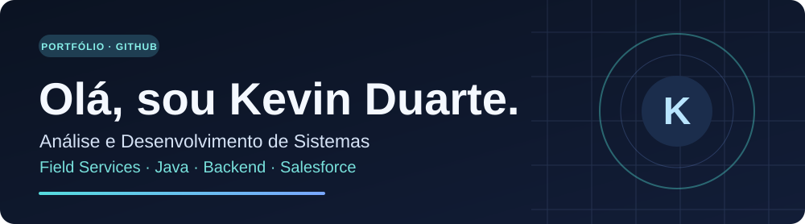

<!-- Versão de prévia para o perfil pessoal: branch preview-perfil-github-2026. Nenhuma métrica foi inventada. -->

### 👋 Sobre mim

Sou formado em **Análise e Desenvolvimento de Sistemas pelo SENAC**. Atualmente, trabalho com **suporte técnico, troubleshooting e resolução de incidentes** em ambientes corporativos, incluindo atendimento relacionado ao **Salesforce**.

Estou direcionando minha carreira para **desenvolvimento de software**, especialmente **Java e backend**. Gosto de aprender na prática, desenvolvendo projetos e explorando novas ferramentas.

**Atualmente estudando:** aprofundamento em Java, AWS e desenvolvimento no ecossistema Salesforce.

---

### 🧰 Linguagens e tecnologias

- **Conhecimentos:** Java · JavaScript · HTML · CSS · SQL/MySQL · Git
- **Experiência profissional:** suporte técnico · troubleshooting · ferramentas corporativas · suporte ao Salesforce
- **Em estudo:** AWS · desenvolvimento Salesforce · aprofundamento em Java backend

---

### 🚀 Projetos em destaque

| Projeto | Descrição |
| --- | --- |
| [**ChronoZone**](https://github.com/kevin1157duarte/ChronoZone-Proj-Final) | Projeto público com Spring |
| [**CadastroDeNinjas**](https://github.com/kevin1157duarte/CadastroDeNinjas) | Projeto público com estrutura Maven |
| [**Portfólio web**](https://github.com/kevin1157duarte/Portfolio) | Site pessoal com página principal e certificados |

Também estudo programação orientada a objetos e projetos de inteligência artificial local.

---

### 📊 Estatísticas do GitHub

  
  

> Os gráficos dependem de um serviço externo e podem ficar indisponíveis. O cartão de linguagens representa a composição dos repositórios, não a proficiência.

---

### 🤝 Contato

Confira meus projetos e contribuições no [**GitHub · kevin1157duarte**](https://github.com/kevin1157duarte).

*Construindo conhecimento, um projeto de cada vez.*
